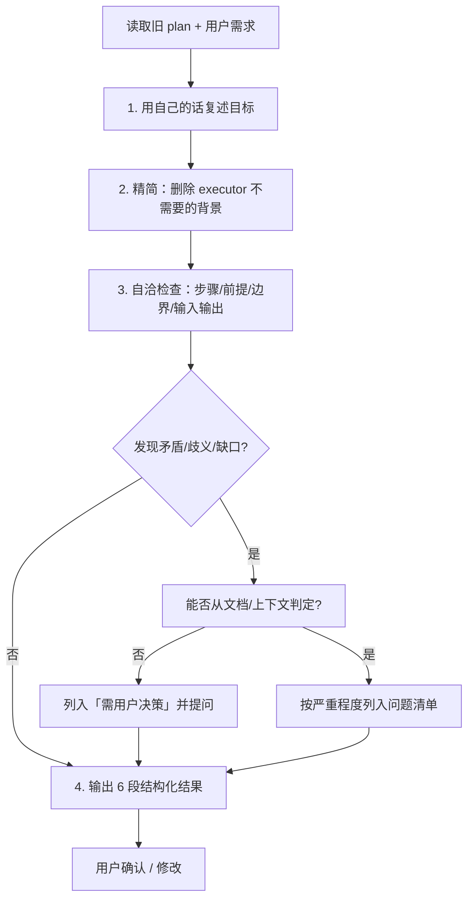

# Revise Plans

Use this skill when reviewing and optimizing an existing plan document. The goal is a self-consistent, executor-ready plan plus a severity-ranked issue list and an explicit set of user-decision items — not a mechanical append of new requirements.

## Core Rules

Follow these rules in order. Violating the letter is violating the spirit.

```markdown
1. 先用自己的话复述 plan 的目标，再开始任何检查或修改。
2. 检查 步骤 / 前提 / 边界 / 输入输出 是否自洽，不只是看前后文是否矛盾。
3. 删除 executor 用不上的背景上下文，只留执行需要的信息。
4. 不确定的地方禁止猜测，必须提问让用户决定。
5. 问题按严重程度排序输出：矛盾 > 歧义 > 缺口。
```

## Iron Law: No Guessing

If a point cannot be resolved from the plan document or surrounding context, you MUST ask the user. Do not infer, do not "pick the most likely interpretation", do not silently fill the gap.

| Excuse | Reality |
|--------|---------|
| "看起来这里应该是 X" | 看起来 ≠ 确定。提问。 |
| "用户大概率想要 X" | 你不是用户。提问。 |
| "为了不打断流程先假设 X" | 假设的 plan 是错的 plan。提问。 |
| "上下文没写，按常识补" | 常识会错。提问。 |
| "这点很小，先放着" | 小缺口也会让 executor 跑偏。提问。 |
| "我给个默认值，用户不否决就按默认走" | 默认值是你的猜测，不是用户的决定。禁止"不回就按默认"。 |

## Decision Items: No Default Auto-Apply

Decision items (第 ⑥ 段) are where the "don't guess" rule gets subverted most often. Follow these exactly:

- 你可以列出可选项（A / B / C），但禁止给出一个"默认值"并声明"不回复就按它走"。
- 沉默 ≠ 同意。用户必须主动选择，你才能把选项写进 plan。
- 在 plan 正文里，未定的决策项一律用显式占位符（如 `【待定·D1】`）标注，不允许写成已确定的值。
- "赶时间""别问"之类的压力不构成授权你替用户拍板。若用户明确说"你可以用默认值"，仍要把采用的默认值逐条列出请用户事后否决，而不是静默套用。

## Workflow



### 1. 复述目标

读完旧 plan 和用户需求后，先用自己的话复述这个 plan 要达成什么、范围边界在哪。复述是为了确认你和用户对目标的理解一致，再动手改。

### 2. 精简 executor 上下文

删除 executor 执行时用不上的背景：历史讨论、废弃方案的来龙去脉、无关的动机铺陈、对 executor 决策无影响的说明。保留执行所必需的目标、步骤、前提、输入输出、验收标准。

被删除的内容要列进输出第 ③ 段，让用户能核对。

### 3. 自洽性检查

对精简后的 plan 检查以下四类自洽性：

- **步骤自洽**：顺序可行，依赖在前，无遗漏或死循环，验收路径能走通。
- **前提自洽**：列出的前提之间不冲突，前提与步骤相符，没有"假设了 A 又假设了非 A"。
- **边界自洽**：范围声明与实际步骤一致，不出现"边界外"的步骤，也不出现"边界内却没步骤覆盖"的空白。
- **输入输出自洽**：每一步的输入来自前序输出或外部声明，输出有去处，无悬空产物或凭空输入。

### 4. 问题分类与排序

发现的问题按严重程度分三类，输出时从高到低排列：

| 类别 | 含义 | 例子 |
|---|---|---|
| 矛盾（最高） | 两处声明直接冲突，plan 无法同时成立 | 步骤 3 依赖产物 A，但步骤 2 输出里没有 A |
| 歧义（中） | 同一表述可被多种解读，executor 会做错 | "先处理异常再继续" 没说处理到什么程度 |
| 缺口（最低） | 必要信息缺失，无法执行 | 没说输入文件格式、没说验收阈值 |

### 5. 决策项单列

凡是无法从文档或上下文判定的点，列入"需用户决策"并提问，不要塞进问题清单假装有答案。每条决策项写清：是什么、为什么需要用户定、可选项（如果能列出）。

## Output Template (REQUIRED)

每次输出必须包含以下 6 段，按顺序。某段无内容就写"无"，不允许整段省略。

```markdown
## 1. 需求复述
<用自己的话复述 plan 的目标和边界>

## 2. 优化后的 plan
<精简 + 自洽修复后的 executor plan 正文>

## 3. 删除的无关上下文
<列出从旧 plan 中删除的、executor 用不上的背景，逐条说明删除理由>

## 4. 自洽性检查结果
<步骤 / 前提 / 边界 / 输入输出 四类的检查结论，逐类说明>

## 5. 按严重程度排序的问题
<矛盾 > 歧义 > 缺口，从高到低列出，每条注明位置与影响>

## 6. 需要用户决策的问题
<无法从文档/上下文判定的点，逐条提问，附可选项>
```

## Operating Notes

- 尊重当前交互模式：只读 / planning 模式下，输出结构化结果而非直接改文件。
- 改动要成比例：针对性修复就够时不要重写整份 plan。
- 保留有用的既有结构，不要为了套模板而推翻原组织方式。
- plan 里的图、表、checklist 若被本次修改影响，必须同步更新。
- 把 plan 当活文档：删掉过时文本，不要留着自相矛盾的历史。
- 第 ② 段的 plan 正文必须是 executor 能直接照着做的版本，背景解释放第 ① 段。
