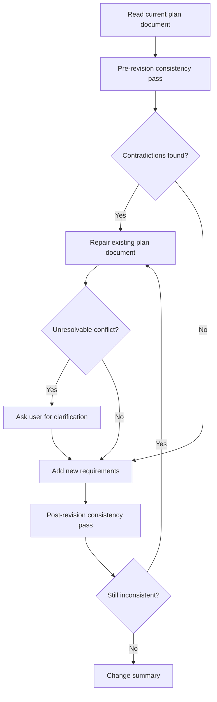

# Revise Plans

Use this skill when revising an existing plan document. The goal is to keep the plan document logically consistent while requirements change, not to append new requirements mechanically.

## Core Rules

Follow these rules in order:

```markdown
1. 先考虑现在的 plan 当中有没有不自洽的地方。如果有，先去修正它。
2. 修正完之后，再加入新的需求。
3. 加入新需求后，再去 run 一遍或者重新反思一遍，看现在这个 plan 当中还有没有不自洽或者前言不搭后语的地方。
```

Do not add new requirements before repairing contradictions in the current plan document, unless the user explicitly asks for a rough draft instead of a coherent revision.

## Workflow

### 1. Pre-revision consistency pass

Read the current plan document before editing. Identify the current goal, scope, requirements, assumptions, steps, dependencies, acceptance criteria, time ordering, and terminology.

Check whether the plan document is self-consistent:

- Goals, scope, steps, dependencies, and acceptance criteria align.
- Earlier decisions do not contradict later decisions.
- Requirements are represented in the relevant implementation steps.
- Dependencies appear before the steps that rely on them.
- Terminology is consistent throughout the plan document.
- Superseded or obsolete steps are not still referenced elsewhere.

### 2. Repair before adding requirements

If the pre-revision consistency pass finds contradictions, repair the existing plan document first.

Make the smallest coherent changes that restore consistency. Preserve the user's intent and the plan document's established structure where possible. Ask the user only when a conflict cannot be resolved from the plan document or surrounding context.

### 3. Add new requirements

After the plan document is internally consistent, add the new requirements.

Integrate new requirements into the most appropriate sections of the plan document. Update affected scope, steps, dependencies, acceptance criteria, risks, diagrams, tables, and checklists. Remove or revise text that the new requirements supersede.

Do not place new requirements only at the end unless the plan document's structure makes that the correct location.

### 4. Post-revision consistency pass

After adding new requirements, re-read the entire plan document as one document.

Check that the revised plan document has no new contradictions, duplicated requirements, obsolete steps, broken ordering, scope drift, missing dependencies, or missing acceptance criteria. Confirm that the execution order and verification path still make sense.

### 5. Change summary

End with a brief change summary that covers:

- Old inconsistencies repaired.
- New requirements added.
- Remaining assumptions, risks, or open questions.

If no old inconsistencies were found, say so briefly.

## Consistency Checklist

Before finalizing a revised plan document, verify:

- The plan document has one clear current goal.
- Scope boundaries match the requirements and implementation steps.
- Requirements are integrated into the relevant sections, not duplicated.
- Terminology is consistent across the plan document.
- Earlier sections do not contradict later sections.
- Dependencies appear before the work that relies on them.
- Acceptance criteria cover the revised requirements.
- Removed or superseded ideas are not still referenced elsewhere.
- Open questions are explicit and do not block the claimed plan unless noted.

## Mermaid Flow



## Operating Notes

- Respect the current interaction mode. In read-only or planning contexts, propose the revised plan document instead of editing files.
- Keep revisions proportional to the requirements change. Do not rewrite the whole plan document when a targeted consistency repair is enough.
- Preserve useful structure rather than inventing a new template.
- Update diagrams, tables, and checklists when revised requirements affect them.
- Treat plan documents as living artifacts: remove obsolete text instead of leaving contradictory history in place.
